# Kubernetes: Resource Allocation, Scheduling \& Load Balancing

## Experiment 04

This experiment demonstrates Kubernetes resource requests and limits, pod scheduling across worker nodes, Deployment scaling, Service endpoints, application access, and resource monitoring.

## Objectives

* Inspect the nodes in a three-node Kubernetes cluster.
* Deploy an Nginx application with CPU and memory requests and limits.
* Observe how Kubernetes schedules pods on worker nodes.
* Scale the Deployment from 6 to 12 replicas.
* Expose the pods through a NodePort Service.
* Verify Service endpoints and access the Nginx application.
* Monitor node and pod CPU and memory usage.

## Environment and Tools

|Item|Details|
|-|-|
|Operating system|Windows 11|
|Container platform|Docker Desktop|
|Kubernetes distribution|kind|
|kind version|v0.33.0|
|Cluster|1 control-plane node and 2 worker nodes|
|Application|Nginx|
|CLI|PowerShell, `kubectl`|

## Repository Contents

|File or folder|Purpose|
|-|-|
|`deployment.yaml`|Nginx Deployment with resource requests and limits|
|`service.yaml`|NodePort Service for the Nginx pods|
|`metrics-server.yaml`|Metrics Server configuration used for cluster monitoring|
|`screenshots/`|Experiment screenshots and generated graphs|

## Cluster Architecture

```text
                    Kubernetes Cluster
                            |
                    Control Plane Node
                       (NoSchedule)
                            |
              +-------------+-------------+
              |                           |
        Worker Node 1                Worker Node 2
         Nginx Pods                   Nginx Pods
              |                           |
              +-------------+-------------+
                            |
                    nginx-service
                     (NodePort)
                            |
                    Nginx Application
```

## Deployment Configuration

The Deployment creates 6 replicas initially. Each container requests 100m CPU and 64Mi memory, with limits of 200m CPU and 128Mi memory.

|Resource|Request per pod|Limit per pod|
|-|-:|-:|
|CPU|100m|200m|
|Memory|64Mi|128Mi|

## Experiment Procedure

### 1\. Verify the Kubernetes cluster

```powershell
kubectl get nodes -o wide
```

The cluster contained one control-plane node and two worker nodes, all in the `Ready` state.

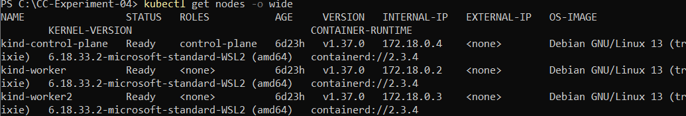

### 2\. Check existing pods

```powershell
kubectl get pods -o wide
```

This command displays pod status, IP addresses, and the nodes on which pods are scheduled.

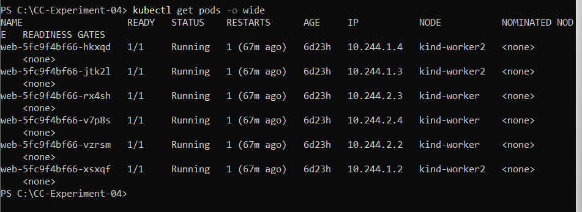

### 3\. Inspect node resource allocation

```powershell
kubectl describe node kind-worker
kubectl describe node kind-worker2
```

Review the **Allocated resources** section for CPU and memory requests and limits.

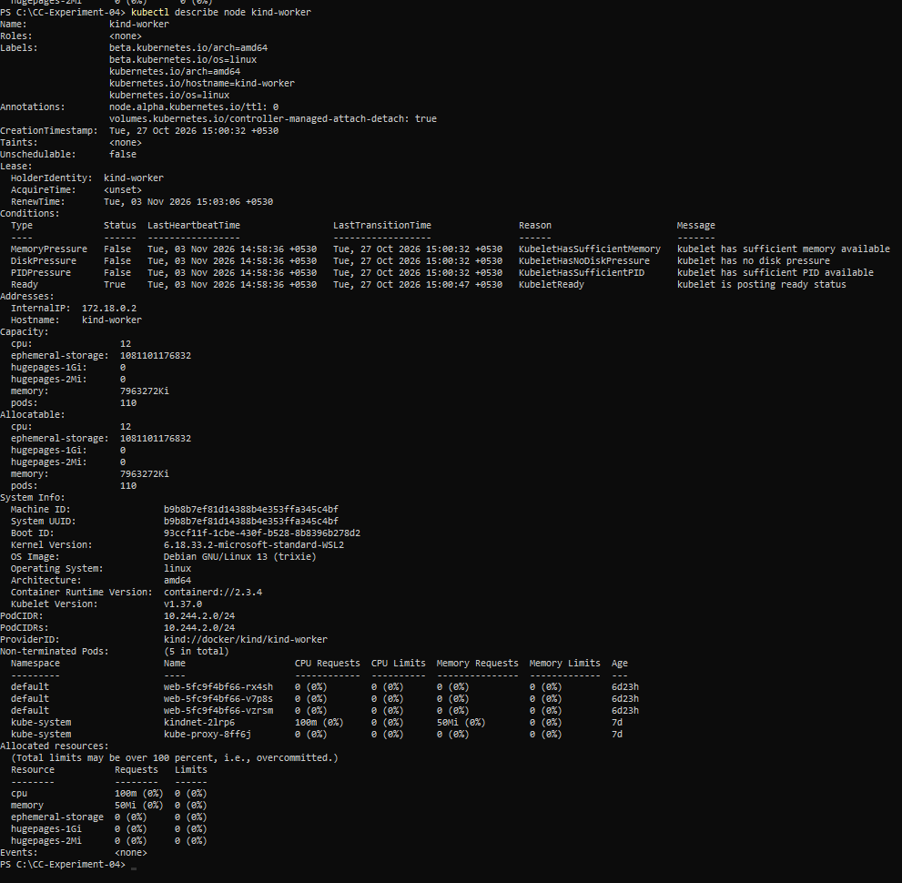

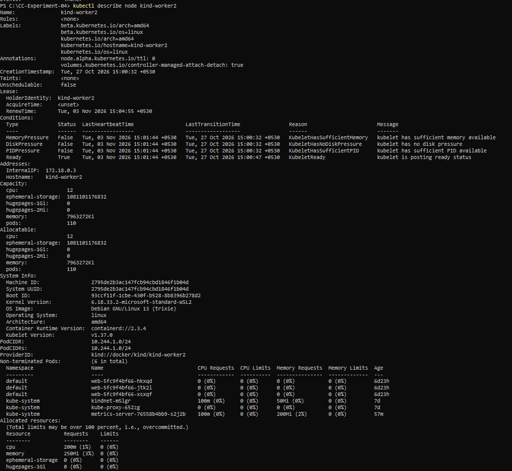

### 4\. Apply the Nginx Deployment

```powershell
kubectl apply -f deployment.yaml
kubectl get pods -o wide
```

The Deployment initially created 6 Nginx replicas. The application pods were scheduled across the two worker nodes. The control-plane node was not used for these pods because it had a `NoSchedule` taint.

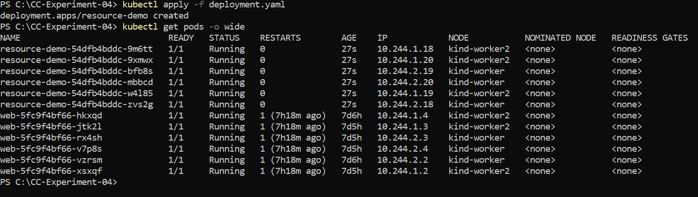

### 5\. Scale the Deployment to 12 replicas

```powershell
kubectl scale deployment resource-demo --replicas=12
kubectl get pods -o wide
```

The Deployment was scaled from 6 to 12 replicas. In the experiment, all 12 application pods reached the `Running` state and were distributed across the two worker nodes.

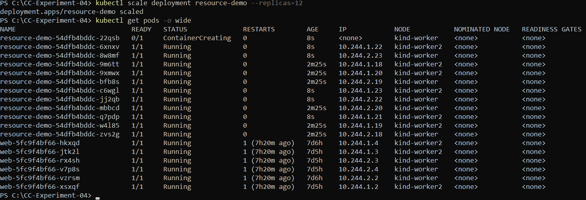

### 6\. Create and inspect the Service

```powershell
kubectl apply -f service.yaml
kubectl get services
kubectl get endpoints nginx-service
kubectl get endpointslices
```

The Service was configured as `NodePort`, using service port `80`, target port `80`, and node port `30080`. Its endpoints corresponded to the 12 application pods.

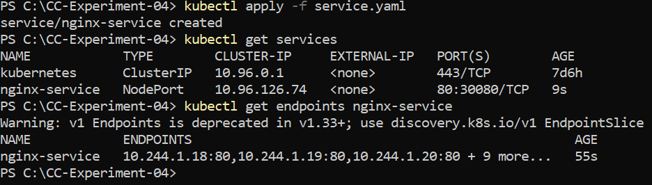

### 7\. Access the Nginx application

In PowerShell, run:

```powershell
kubectl port-forward service/nginx-service 8080:80
```

Keep the port-forward process running and open `http://localhost:8080` in a browser. The Nginx Welcome page was displayed successfully. In this Kind-on-Windows setup, the application was tested using port forwarding.

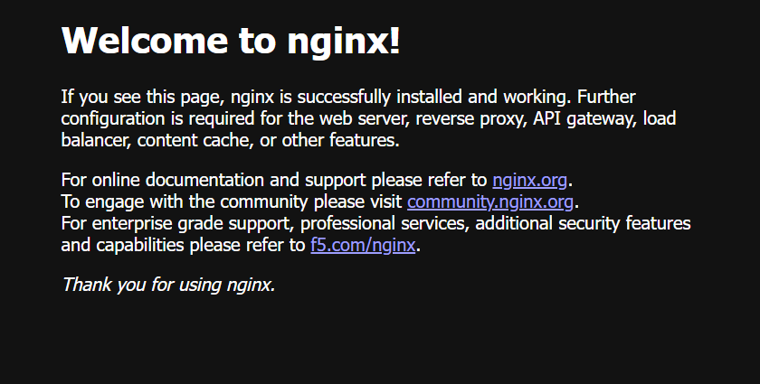

### 8\. Monitor node and pod resource usage

```powershell
kubectl top nodes
kubectl top pods
```

Metrics Server was installed/configured because the Metrics API was initially unavailable.

Observed node metrics during the experiment:

|Node|CPU usage|Memory usage|
|-|-:|-:|
|`kind-control-plane`|237m|679Mi|
|`kind-worker`|65m|372Mi|
|`kind-worker2`|67m|433Mi|

At the time of measurement, each of the 12 `resource-demo` pods showed approximately `0m` CPU and `10Mi` memory.

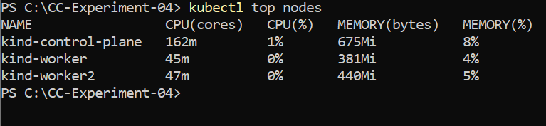

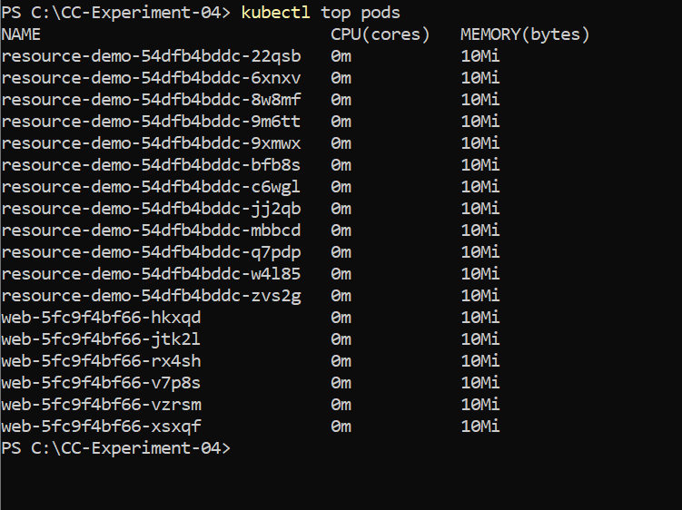

## Graphs

### Deployment scaling

The replica count increased from 6 to 12.

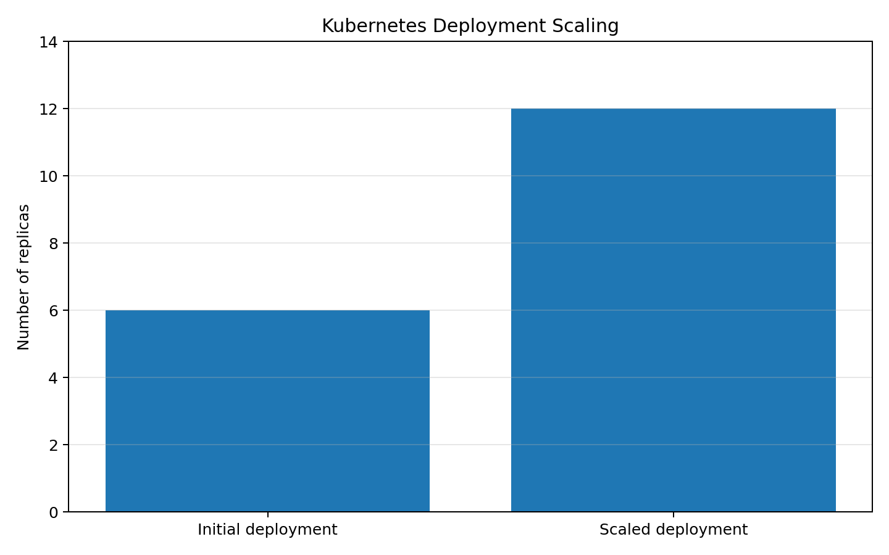

### Aggregate resource configuration for 12 replicas

For 12 replicas, aggregate configured requests and limits are:

|Resource|Total requests|Total limits|
|-|-:|-:|
|CPU|1200m|2400m|
|Memory|768Mi|1536Mi|

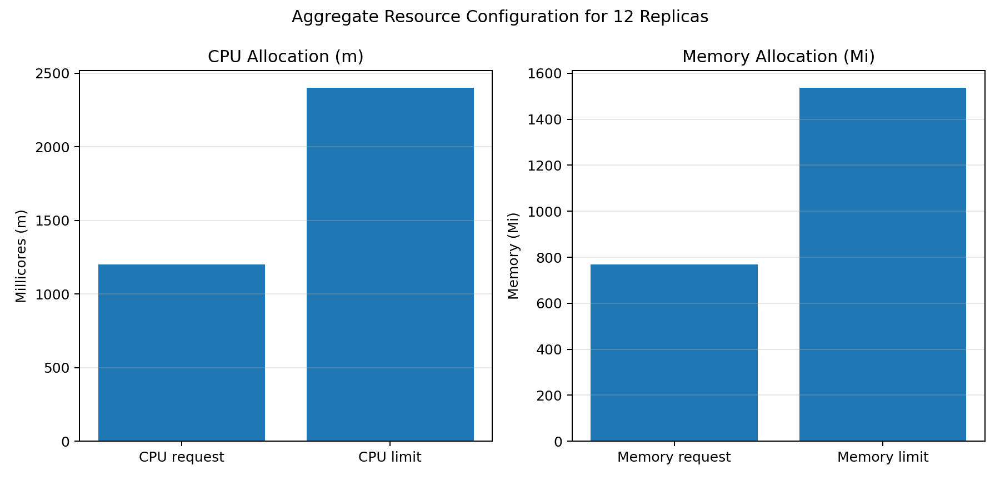

*These graphs show configured replica counts and resource requests/limits. They are not measured utilization graphs.*

## Results and Observations

1. Verified a three-node Kind cluster with one control-plane node and two worker nodes.
2. Created an Nginx Deployment with 6 replicas.
3. Configured CPU and memory requests and limits for each container.
4. Observed application pods scheduled across the two worker nodes.
5. Scaled the Deployment from 6 to 12 replicas.
6. Created a NodePort Service and verified its endpoints.
7. Accessed the Nginx Welcome page using `kubectl port-forward`.
8. Monitored CPU and memory usage using Metrics Server.
9. Deleted the experiment Deployment and Service during cleanup.

## Cleanup

The experiment resources were removed using:

```powershell
kubectl delete service nginx-service
kubectl delete deployment resource-demo
```

The existing `web` Deployment and the Kind cluster were preserved. Metrics Server remained installed in the `kube-system` namespace.

## Conclusion

The experiment demonstrated Kubernetes resource allocation, pod scheduling, Deployment scaling, Service configuration, and resource monitoring. The Nginx Deployment was scaled from 6 to 12 replicas, and the pods were scheduled across the two worker nodes. The NodePort Service exposed the application, which was successfully tested through port forwarding. Metrics Server provided CPU and memory usage information for nodes and pods.

## Author

**Vandana A M**


